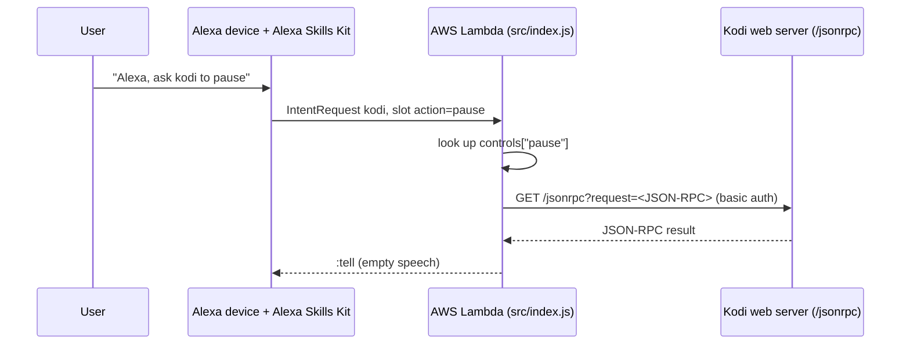

# alexaSkill

Kodi voice remote for Amazon Alexa: an AWS Lambda skill that turns a spoken command into a Kodi JSON-RPC call.

## Overview

A small 2017 experiment for controlling a Kodi media center by voice. The user says a command word to an Alexa
device ("pause", "home", "mute", "next"...); the skill maps that word to a predefined Kodi JSON-RPC request and sends it
over HTTP, with basic auth, to the Kodi web server. Alexa replies with an empty response, so the feedback is what
happens on the TV.

## Features

- One custom intent (`kodi`) with a single slot (`action`) that carries the command word.
- 38 predefined commands mapped to Kodi JSON-RPC methods:
  - navigation: `up`, `down`, `left`, `right`, `select`, `back`, `home`, `info`, `show`, `ContextMenu`, `pageup`, `jump`, `talk` (sends the text "home")
  - playback: `play`, `pause`, `stop`, `next`, `previous`, `fast`, `rewind`, `fullscreen`, `screenshot`
  - volume: `mute`, `unmute`, `whisper` (25 %), `speak` (50 %), `scream` (100 %)
  - windows and add-ons: `music`, `favourites`, `channels`, `radio`, `moviesearch`, `tvSearch`, `series`, `webcam`
  - on-screen notifications: `hi`, `warning`, `sorry` (the fallback when no slot value arrives)
- `assets/kodiApi.json`: a copy of Kodi's JSON-RPC service description, kept as a reference for writing new commands.

## Architecture



## Requirements

- An Amazon developer account (Alexa Skills Kit) and an AWS account for Lambda.
- Node.js. The SAM template targets the `nodejs6.10` runtime, which AWS no longer supports; a current runtime would be
  needed to deploy today.
- A Kodi instance with the web server (HTTP control) enabled, reachable from the internet by the Lambda function.

## Installation

```bash
git clone https://github.com/Lapeyus/alexaSkill.git
cd alexaSkill/src
npm install          # alexa-sdk ^1.0.10 (node_modules/ is also committed)
```

Then edit the placeholders at the top of `src/index.js` (see Configuration), zip the contents of `src/` and upload it
as a Lambda function, or deploy with the SAM template in `assets/Mirror.yaml` (its `CodeUri` and `Role` must be
adapted to your account).

In the Alexa developer console, create a custom skill with an intent named `kodi` that has a slot named `action`, and
point its endpoint at the Lambda function. The interaction model is not stored in this repository.

## Usage

Say the invocation name you chose plus one of the command words, for example "pause", "home", "scream" or "series".
Any unknown word or empty slot sends the `sorry` notification to Kodi.

To add a command, add an entry to the `controls` object in `src/index.js` whose value is the JSON-RPC request string;
`assets/kodiApi.json` lists the available methods and parameters.

## Repository layout

```text
.
├── src/
│   ├── index.js          # skill handlers, command map, HTTP helper
│   ├── package.json      # depends on alexa-sdk
│   └── node_modules/     # vendored dependencies (alexa-sdk, aws-sdk, ...)
├── assets/
│   ├── Mirror.yaml       # AWS SAM template for the Lambda function
│   ├── kodiApi.json      # Kodi JSON-RPC service description (reference)
│   └── kodi_*.png        # skill icons (108x108 and 512x512)
└── .gitignore
```

## Configuration

Placeholders at the top of `src/index.js`, to be replaced before deploying:

| Name | Meaning |
|---|---|
| `http_host` | Hostname or IP of the Kodi web server |
| `host_port` | Kodi web server port (currently an undefined identifier `port`, so the file fails until it is set) |
| `auth` | Kodi web server credentials as `user:password` |
| `APP_ID` | Alexa skill ID (declared but not used; the `alexa.appId` line is commented out) |

Do not commit real values: the repository is public. There is no `.env` or config file; values live in the source.

## Tests

None.

## Deployment

Manual, through the AWS Lambda console or `sam deploy` with `assets/Mirror.yaml` (128 MB, 7 s timeout, triggered by
the Alexa Skills Kit event).

## Project status

Archived experiment. Twelve commits between 12 and 13 July 2017; no activity since.

### Known limitations

- Despite the variable name `https`, the helper uses Node's `http` module: requests and basic-auth credentials travel
  unencrypted to Kodi.
- The `AMAZON.StopIntent` handler references an undefined `STOP_MESSAGE` and will throw.
- The skill never speaks a result: the `kodi` handler builds a response string but emits an empty `:tell`.
- No error handling for network failures or non-JSON responses from Kodi.
- Several commands depend on third-party Kodi add-ons being installed (YouTube, TuneIn and others).
- `node_modules/` is committed, including a full copy of `aws-sdk`.

## License

No license file is included.
